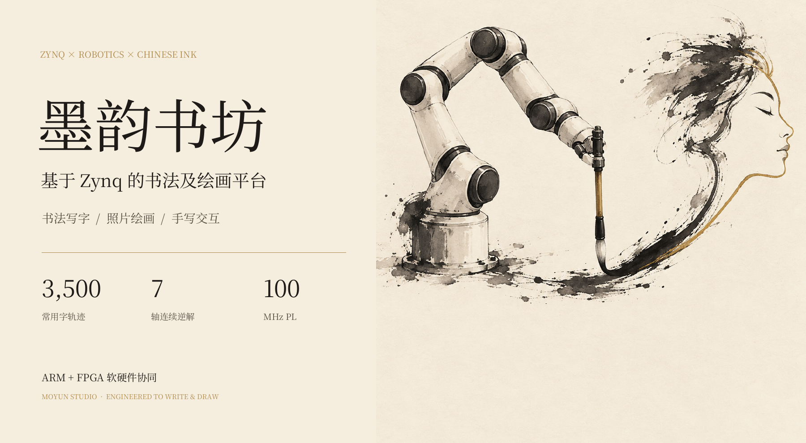
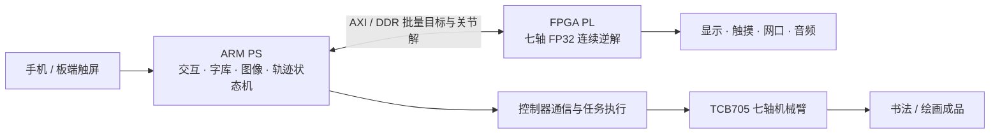
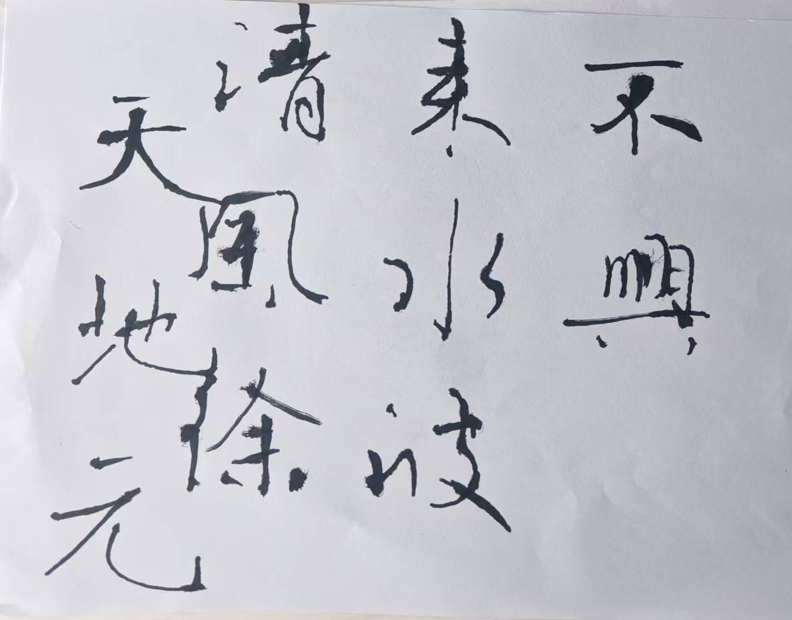
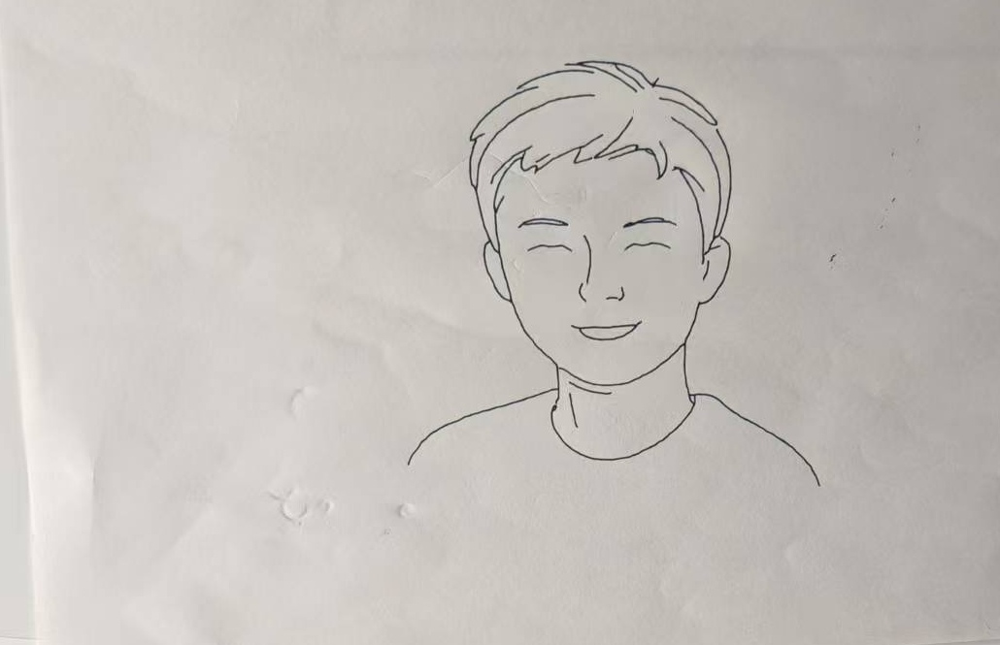
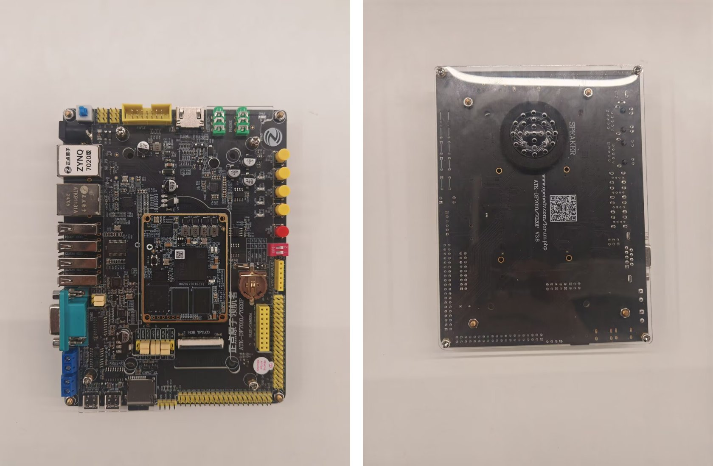

<div align="center">

# 墨韵书坊 · Moyun Studio

### 基于 Zynq 的书法及绘画平台

**一块开发板，一台七轴机械臂，让文字与图像落在纸上。**




[快速开始](docs/quickstart.md) · [系统架构](docs/architecture_overview.md) · [验证与性能](docs/validation_summary.md) · [硬件重建](docs/hardware_build.md) · [三版海报](docs/posters/README.md)

[技术报告 PDF](docs/design_report.pdf)

</div>

## 作品概览

墨韵书坊将毛笔书写、照片线稿绘制与触屏手写交互整合在 Zynq-7020 上。板端触屏承载操作界面，手机扫码完成输入，TCB705 七轴机械臂执行书写与绘画；本地字库和识字功能可离线运行，照片的 AI 风格转换按配置调用云端服务。

| 书 · 毛笔写字 | 画 · 照片绘画 | 互 · 手写学习 |
|---|---|---|
| 3,500 常用字与 88 项笔画模块 | 手机上传、云端线稿、中心线提取 | 屏上手写、笔画复写、离线识字 |
| 文字排版、诗词、春联与名帖入口 | 连续笔画、抬落笔与七轴轨迹规划 | 3,755 类汉字识别、板端音频朗读 |
| 毛笔提按由标定高度与笔画模板表达 | 硬笔绘图与本地线稿库 | 独立的任务会话、停止与取消处理 |

## 软硬件协同



七轴逆解核采用“几何分解 → CORDIC 与连续选解 → 顺序写出”的三级 DATAFLOW；通过前一节点关节解选择连续分支，批量接口保留成功前缀并支持取消。PS 处理交互、轨迹编排、纸面标定与控制器通信。PL 不直接接管机械臂伺服。

| 指标 | 结果 | 验证口径与原始证据 |
|---|---:|---|
| 七轴逆解吞吐 | 约 **11.6 万点/s** | 100 MHz，64 点/事务、55,043–55,123 周期，[RTL 协同仿真](hw/reports/parallel_fp32_20261024/hls/throughput_cycles.xml) |
| 连续历史轨迹回放 | **21,679 点，0 回退** | 同源 HLS C++ 离线回放，[完整轨迹记录](hw/reports/parallel_fp32_20261024/full_trajectory/README.md) |
| 最大位置计算误差 | **0.39 µm** | 上述轨迹的模型内 FP64 正解对照，非落纸精度 |
| 完整平台 LUT | **40,048 / 53,200，75.28%** | 2026-10-27 音频 IOBUF 修正版，[布线后资源报告](hw/reports/audio_iobuf_20261027/utilization.rpt) |
| 完整平台 WNS / WHS | **+0.136 / +0.011 ns** | [布线后验收记录](hw/reports/audio_iobuf_20261027/build_verified.json) |

核级、板端与实物结果按版本分别保存。[验证说明](docs/validation_summary.md)也给出当前板端 CPU/PL 整图规划对照，便于完整理解调度与数据搬运开销。

## 实物与作品

下图为项目已有实拍素材，展示毛笔书写、硬笔人像与 Zynq 板卡。

| 毛笔书写 | 硬笔绘画 | Zynq 平台 |
|---|---|---|
|  |  |  |

## 快速开始

需要 Python 3.11；以下为桌面模拟模式，数据保存在 `build/demo`。

```bash
git clone https://github.com/T1vey/moyun-shufang.git
cd moyun-shufang
python -m venv .venv
# Windows PowerShell 7: ./.venv/Scripts/Activate.ps1
# Linux/macOS: source .venv/bin/activate
python -m pip install -r requirements-public-demo.txt
python scripts/prepare_public_data.py
python scripts/run_tcb705.py --simulation --profile robots/tcb705/profile.demo.json --data-dir build/demo --web-port 8095 --backend-port 8785
```

浏览器访问 `http://127.0.0.1:8095/`。模拟模式不连接机械臂。原生规划库按 [快速开始](docs/quickstart.md)编译；云端图生图和实物 SDK 为可选配置，凭据由使用者本地填写。

## 工程导航

| 路径 | 内容 |
|---|---|
| [`tcb705/`](tcb705/README.md) · [`native/tcb_planner/`](native/README.md) | 七轴模型、规划、C++ 几何与控制器执行 |
| [`user_gui/`](user_gui/README.md) · [`calligraphy/`](calligraphy/) · [`handwriting/`](handwriting/README.md) | 触屏、扫码、书法、手写交互 |
| [`hls_source/tcb705_parallel_fp32/`](hls_source/tcb705_parallel_fp32/README.md) | 当前七轴 FP32 HLS 源码、接口与测试 |
| [`hw/`](hw/README.md) · [`overlay/`](overlay/) | RTL、约束、Vivado 重建脚本、平台元数据 |
| [`hw/reports/`](hw/reports/) · [`reports/`](reports/) | 综合、实现、仿真与板端验证记录 |
| [`tests/`](tests/README.md) · [`scripts/`](scripts/README.md) | 软件回归、构建、部署与调试工具 |
| [`skills/pynq-release-audit/`](skills/pynq-release-audit/SKILL.md) | 可迁移的 PYNQ 发布核对技能与只读检查脚本 |
| [`docs/posters/`](docs/posters/README.md) | 三版 A3 海报、PDF、生成提示词与排版源码 |

## 参赛提交与复现

本仓库按用户提供的 `ZYNQArm1029.zip`（2026-10-29 源码快照）整理。为保留现有导入与部署关系，应用目录维持原布局，早期 SO-101 兼容模块与 TCB705 主线分开说明。当前器件为 **XC7Z020CLG400-2**，现有构建工具为 **Vivado / Vitis 2024.2**。

源码、必要输入、测试与结果报告入库；虚拟环境、API 密钥、实机私有标定、构建缓存、原始归档和本机二进制不入库。匹配平台的 bit/hwh 必须按脚本重建；商业 SDK 由设备持有者从厂商取得。见[提交清单](docs/submission_checklist.md)和[来源记录](THIRD_PARTY_NOTICES.md)。海报封面为 AI 创作示意，不作为实物照片或测试证据。

## 许可

本项目独立应用与整理代码采用 [MIT](LICENSE)。ArmVision 参考文件、Make Me a Hanzi 派生字形、第三方模型、AMD/厂商 IP 等沿用各自条款，详见 [THIRD_PARTY_NOTICES.md](THIRD_PARTY_NOTICES.md)。
