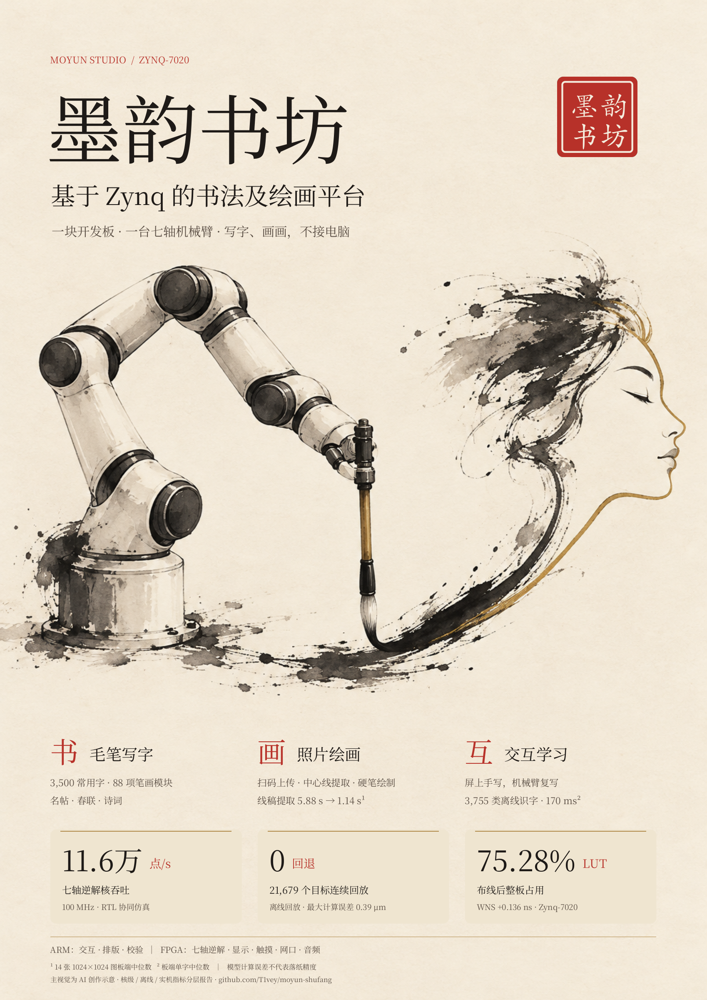
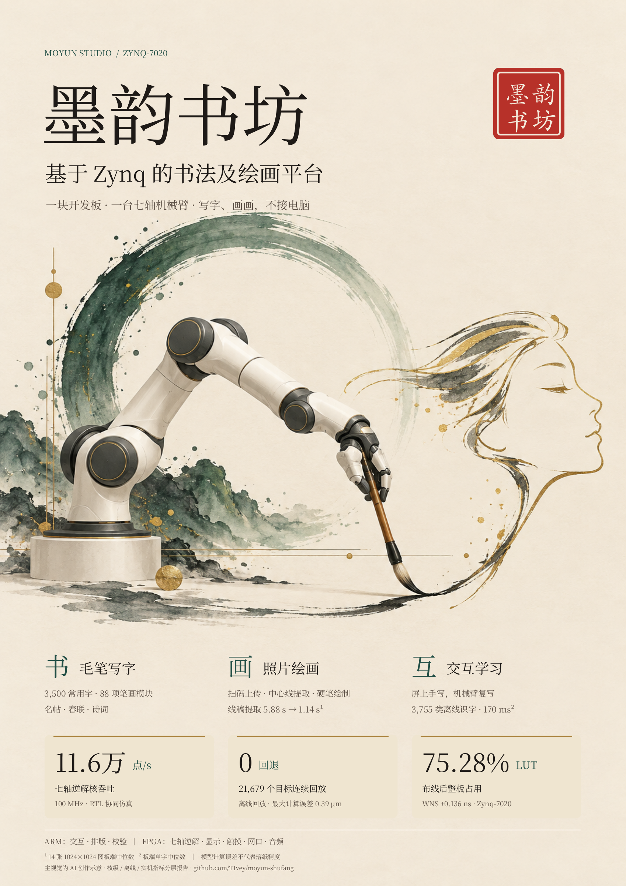
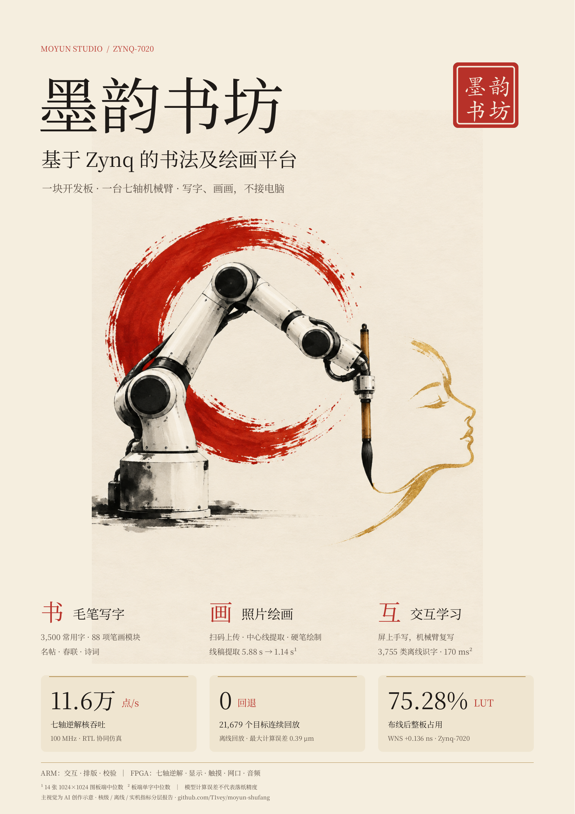

# 三版作品海报

**当前采用 A 方向的修订版：[实物封面与八页详情海报](editorial_v2/README.md)。** 标题改用行楷，正文换为黑体，主视觉改用项目实拍。以下保留最初三版作为设计记录。

共同内容：墨韵书坊；基于 Zynq 的书法及绘画平台；书、画、互三组功能；11.6 万点/s、0 回退、75.28% LUT 三项分层指标。全部使用本机 Noto Serif SC（思源宋体系同源字体）排版，不分发字体文件。

| A · 水墨金线 | B · 青绿雅韵 | C · 朱砂印象 |
|---|---|---|
|  |  |  |
| [A3 PDF](poster_a.pdf) | [A3 PDF](poster_b.pdf) | [A3 PDF](poster_c.pdf) |

主视觉通过内置 imagegen 分别生成，原始图位于 `artwork/`，三份最终提示词见 `prompts.json`；文字、印章与指标由 `build_posters.py` 独立排版为 PDF 矢量文字，避免生成文字出错。主视觉为概念插画，不是实物照片。仓库首页暂用 A 版衍生横版封面。

## 再生成排版

```bash
python -m pip install reportlab
python docs/posters/build_posters.py --regular /path/to/serif_regular.ttf --bold /path/to/serif_bold.ttf --heavy /path/to/serif_heavy.ttf
```

另需 Poppler 的 `pdftoppm`，或通过 `--poppler` 指定绝对路径。页面尺寸 297 × 420 mm，预览长边 2400 像素，每个 PDF 均为一页并低于 50 MB。PNG 便于预览，提交和印刷优先使用 PDF。

指南的决赛英文 A4 官方模板海报是另一个材料要求，见 `../submission_checklist.md`。
