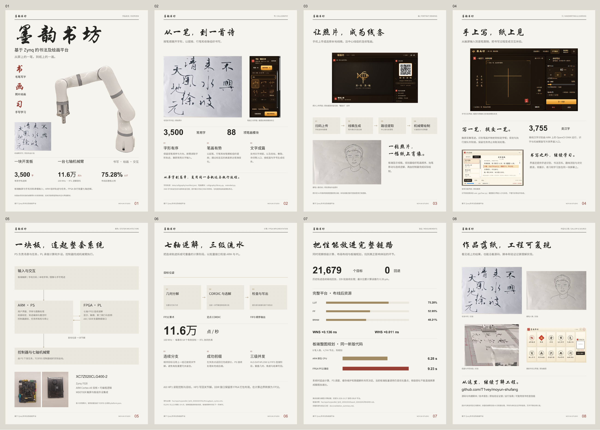

# A 版修订 · 八页作品海报

采用米白、墨黑、暗金和少量朱红的编辑设计。封面以真实机械臂和实写片段为主体，后续页面展开功能、架构与验证。



**[完整八页 A3 PDF](moyun_editorial_8p.pdf)** · **[独立封面 A3 PDF](moyun_cover_a_v2.pdf)**

| 页 | 内容 | 图片 |
|---|---|---|
| 01 | 作品总览：真实机械臂、实写片段与核心功能 | [PNG](page-1.png) |
| 02 | 毛笔书法：字库、笔画与排版 | [PNG](page-2.png) |
| 03 | 照片绘画：输入、线稿、路径与纸上作品 | [PNG](page-3.png) |
| 04 | 手写学习：逐笔交互、识字与诗文朗读 | [PNG](page-4.png) |
| 05 | 系统架构：输入、PS/PL 与控制器 | [PNG](page-5.png) |
| 06 | FPGA 逆解：三级 DATAFLOW 与连续分支 | [PNG](page-6.png) |
| 07 | 验证结果：离线回放、整板资源与板端规划 | [PNG](page-7.png) |
| 08 | 作品与复现：实物、界面与源码入口 | [PNG](page-8.png) |

## 字体与图像

- 标题使用 **华文行楷**，正文使用 **Noto Sans SC 黑体**，英文与数字使用 **Arial**。数字中的中文单位使用黑体回退，保证全部字形可见。
- 字体来自本机合法安装，PDF 内嵌子集；仓库不分发字体文件。
- 封面机械臂来自项目实拍 `arm_front.jpg`，通过内置 imagegen 去除背景。最终编辑提示词见 [image_edit_prompt.json](image_edit_prompt.json)。
- 成品、板卡与界面截图保持原图，在 PDF 中排版放置。模拟界面保留其原有状态标记，旧版名称也保留在截图内。
- 原始照片与输出的哈希登记在 `asset_provenance.json`。

## 排版再生成

```bash
python -m pip install reportlab pypdf Pillow
python docs/posters/editorial_v2/build_editorial.py --sans-regular /path/to/sans_regular.ttf --sans-bold /path/to/sans_bold.ttf --calligraphy /path/to/calligraphy.ttf --latin-regular /path/to/arial.ttf --latin-bold /path/to/arialbd.ttf
```

另需 Poppler 的 `pdftoppm`，可用 `--poppler` 指定路径。输出包括完整 PDF、独立封面、八页 PNG、总览图和仓库横版封面。A3 页面为 297 × 420 mm，两份最终 PDF 均小于 50 MB。

`layout_text_audit.json` 记录所有正文文本的位置和字号。关键数字的测试条件位于第 6、7 页，原始文件见仓库 `hw/reports/` 与 `docs/validation_summary.md`。
