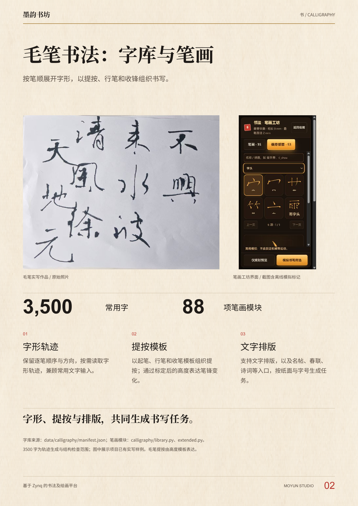
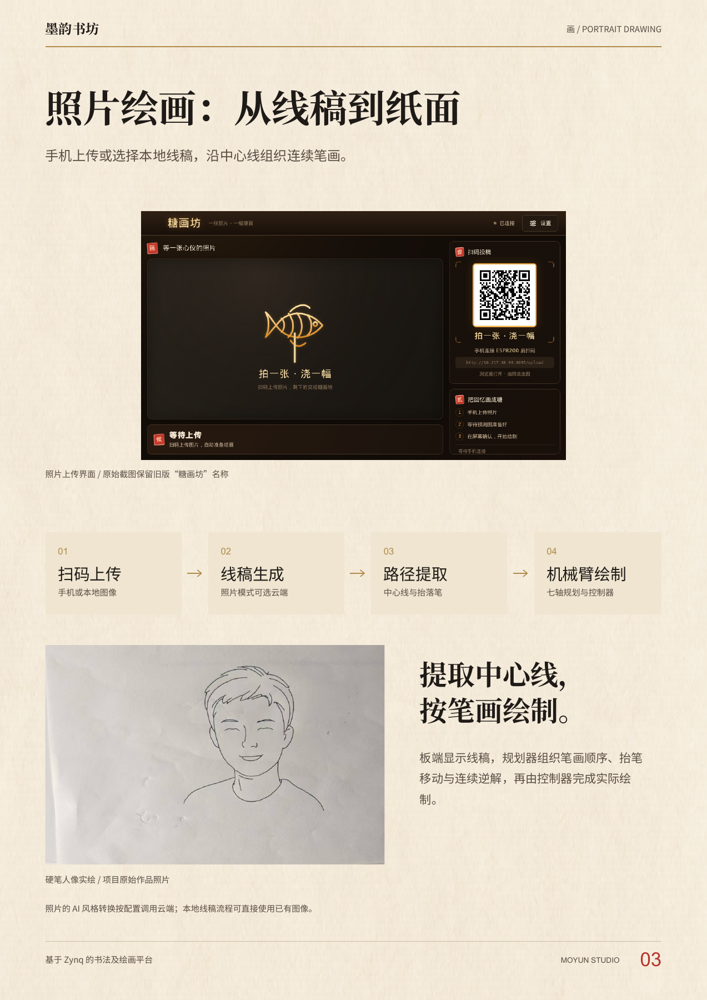
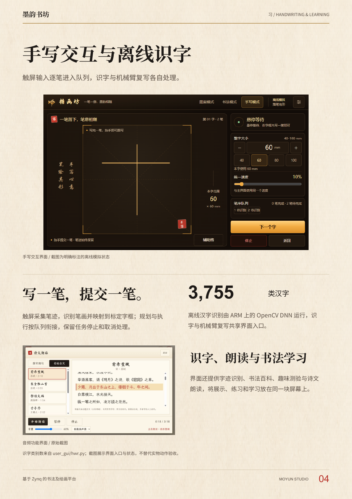
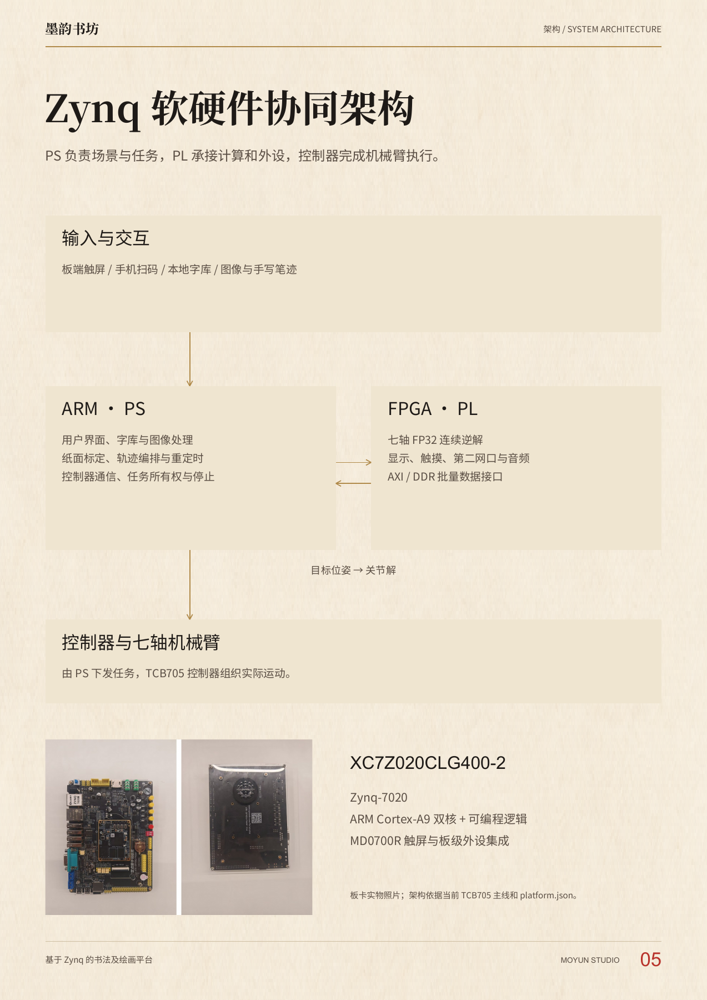
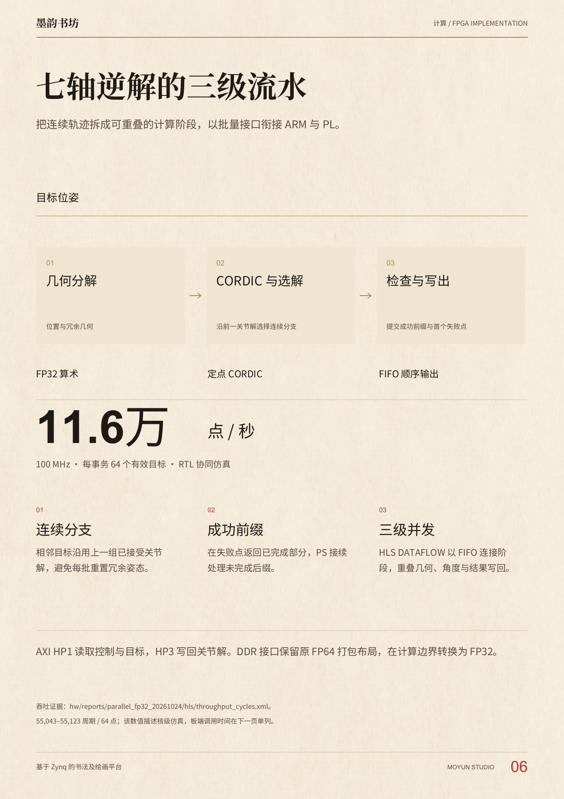
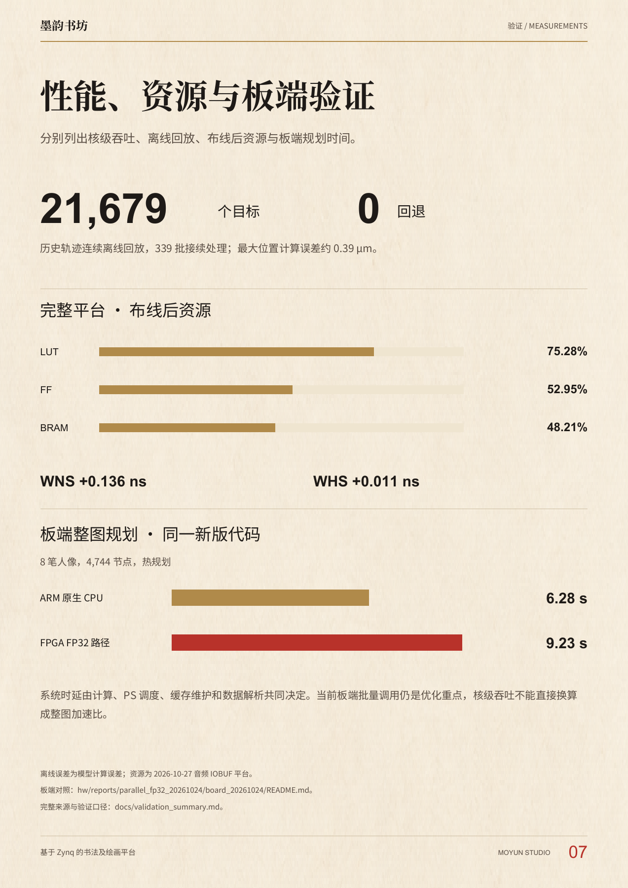
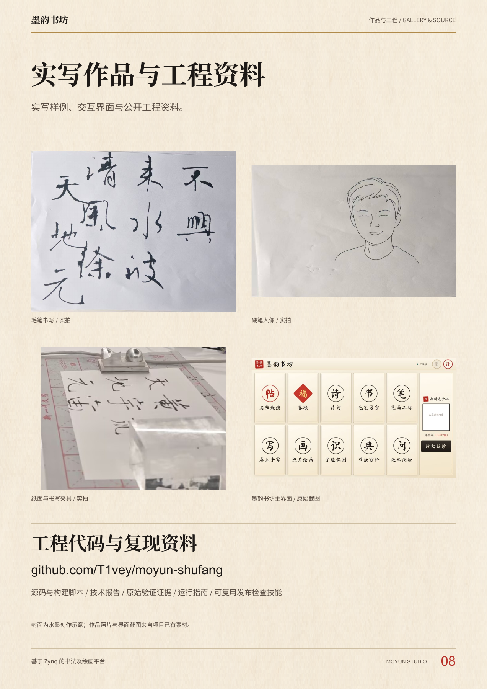

# 墨韵书坊 · 八页作品海报

原 A 版水墨主海报与七页详情，依次展示功能、系统架构、FPGA 实现、验证和作品。

**[完整八页 PDF](moyun_ink_a_8p.pdf)** · **[单页主海报 PDF](moyun_a_text_refined.pdf)** · [八页总览](overview_8p.png) · [项目首页](../../../README.md)

## 在线阅读

[主海报](#主海报) · [毛笔书法](#毛笔书法) · [照片绘画](#照片绘画) · [手写交互](#手写交互) · [系统架构](#系统架构) · [七轴逆解](#七轴逆解) · [性能与验证](#性能与验证) · [实写作品](#实写作品)

点击图片可查看原图。

### 主海报

<p align="center">
  <a href="page-1.png">
    
  </a>
</p>

### 毛笔书法

<p align="center">
  <a href="page-2.png">
    
  </a>
</p>

### 照片绘画

<p align="center">
  <a href="page-3.png">
    
  </a>
</p>

### 手写交互

<p align="center">
  <a href="page-4.png">
    
  </a>
</p>

### 系统架构

<p align="center">
  <a href="page-5.png">
    
  </a>
</p>

### 七轴逆解

<p align="center">
  <a href="page-6.png">
    
  </a>
</p>

### 性能与验证

<p align="center">
  <a href="page-7.png">
    
  </a>
</p>

### 实写作品

<p align="center">
  <a href="page-8.png">
    
  </a>
</p>

[返回在线阅读目录 ↑](#在线阅读)

<details>
<summary>版式说明、素材来源与再生成</summary>

## 修改范围

| 区域 | 处理 |
|---|---|
| 封面上方与主视觉 | 直接保留原 A 版 PDF 内容；2400 像素长边渲染后，上方 1734 行像素对照完全一致 |
| 书 / 画 / 互 | 换用黑体，缩短功能说明，减少口号式文字 |
| 数字区 | 保留三项指标与条件，改为细线分隔，去掉圆角底卡 |
| 页脚 | 用简短文字说明 ARM/FPGA 分工和指标条件 |
| 详情页 | 保留七页内容，使用原 A 的宣纸、墨黑、朱红与暗金配色；穿插实写作品、界面与技术图 |

封面底部正文使用 Noto Sans SC，数字使用 Arial 与中文字体回退。详情标题使用与原 A 版同系的宋体。原始图片未重新生成，封面上半页也未重新排版。字体文件不随仓库分发。

## 页面

1. 原 A 版主海报 · 下方文字修订
2. 毛笔书法：字库与笔画
3. 照片绘画：从线稿到纸面
4. 手写交互与离线识字
5. Zynq 软硬件协同架构
6. 七轴逆解的三级流水
7. 性能、资源与板端验证
8. 实写作品与工程资料

每页 PNG 为 `page-1.png` 至 `page-8.png`；封面高清图为 `cover_full.png`。

## 来源与再生成

- 原 A 版：[poster_a.pdf](../poster_a.pdf)、[art_a.png](../artwork/art_a.png)。
- 详情页复用已有 [排版与内容模块](../editorial_v2/build_editorial.py)，更新视觉和文字；实拍与截图来源见 [素材记录](../editorial_v2/asset_provenance.json)。本版不使用去背景机械臂封面。
- 上方内容保留、像素对照和文件大小的记录见 [validation.json](validation.json)。

```bash
python -m pip install reportlab pypdf Pillow
python docs/posters/ink_a_v3/build_ink_a.py --sans-regular /path/to/sans_regular.ttf --sans-bold /path/to/sans_bold.ttf --serif-bold /path/to/serif_bold.ttf --serif-heavy /path/to/serif_heavy.ttf --latin-regular /path/to/arial.ttf --latin-bold /path/to/arialbd.ttf
```

另需 Poppler，可用 `--poppler` 指定 `pdftoppm`。页面为 A3 竖版，两份最终 PDF 均小于 50 MB。

</details>
